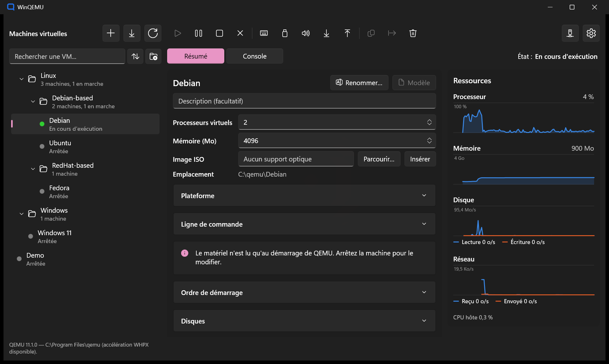
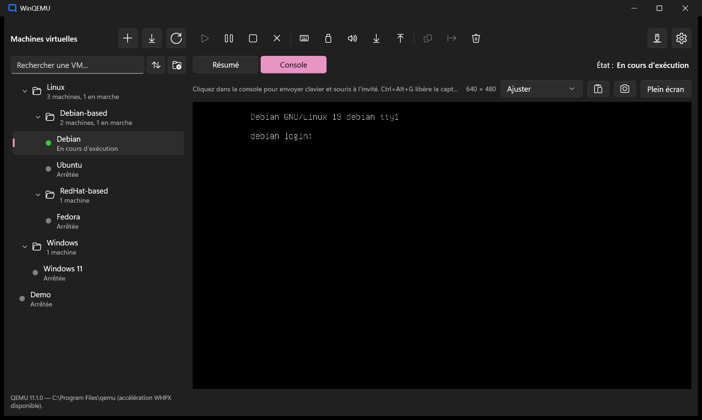
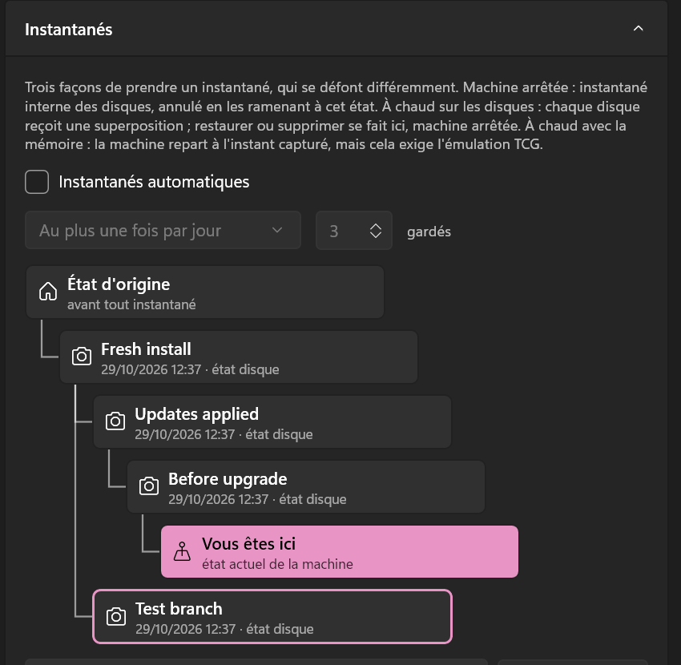

[English](README.md) · **Français**

# WinQEMU

Interface graphique Windows (WinUI 3) au-dessus de [QEMU](https://www.qemu.org/), qui vise le confort de VMware
Workstation ou d'Hyper-V. On crée, lance et pilote ses machines virtuelles sans écrire de ligne de commande, avec
l'accélération matérielle de la plateforme d'hyperviseur Windows (WHPX).





> WinQEMU est une interface indépendante et non officielle : il n'est ni affilié au projet QEMU, ni approuvé par lui.
> QEMU est une marque de Fabrice Bellard. Ce projet n'a pas non plus de lien avec l'ancien portage de QEMU vers
> Visual C++ également nommé WinQEMU (SourceForge, 2009), abandonné depuis.

## Fonctionnalités

### Machines virtuelles

- **Bibliothèque** :
  - chaque machine est un dossier autonome (descripteur `.wqvm`, disques, NVRAM UEFI), déplaçable tel quel ;
  - les machines se rangent dans des dossiers imbriqués, avec tri et recherche ;
  - un dossier entier se démarre, s'arrête, se met en pause ou reprend en un clic, comme les « teams » de VMware : ses
    machines démarrent l'une après l'autre, chacune après son propre délai.
- **Assistant de création** :
  - profils de systèmes invités ;
  - mémoire, processeurs, disques, ISO, micrologiciel BIOS ou UEFI.
- **Installation automatique** de Windows 10/11 et d'Ubuntu :
  - compte utilisateur, langue, clavier et fuseau horaire repris de ce PC ;
  - outils invités installés d'office.
- **Invités Windows 11** : les contrôles du TPM et du Secure Boot, impossibles sous WHPX, sont levés à l'installation.
- **Import** depuis VMware (`.vmx`), VirtualBox (`.vbox`), Hyper-V (`.vhdx`/`.vhd`) et OVF/OVA :
  - les disques sont convertis en qcow2 ;
  - la machine source n'est que lue.
- **Export** en OVA, lisible par VMware et VirtualBox.
- **Clones**, en copie complète ou en clones liés qui partagent les disques de l'original.
- **Modèles** : une machine gardée pour être déployée en nouveaux clones liés en quelques secondes.
- **Démarrage automatique** avec WinQEMU, à l'ouverture de session Windows si on le souhaite, chaque machine après son propre délai.
- **Fonctionnement en arrière-plan** :
  - fermer la fenêtre laisse les machines tourner, derrière une icône dans la zone de notification ;
  - l'arrêt ou la déconnexion de Windows attend que les invités s'éteignent.

### Console

- **Console intégrée**, ou plein écran avec une barre flottante.
- **Mise à l'échelle** : ajustée à la fenêtre ou en taille réelle. La résolution de l'invité suit la fenêtre, invités Windows compris.
- **Clavier** transmis en scancodes, AltGr compris : l'invité garde sa propre disposition.
- **Pointeur** : précis même quand l'image est mise à l'échelle.
- **Presse-papiers partagé** (texte) avec les invités équipés de `spice-vdagent`.
- **Taper le presse-papiers** dans un invité sans presse-papiers partagé : console texte, installateur, écran du micrologiciel.
- **Capture d'écran** en PNG, à la résolution de l'invité, copiée aussi dans le presse-papiers.
- **Fichiers** :
  - fichiers et dossiers déposés sur la console sont copiés sur le Bureau de l'invité ;
  - on récupère des fichiers de l'invité en parcourant ses dossiers.
- **Son** :
  - volume et coupure par machine ;
  - micro sur demande ;
  - choix de la sortie audio.
- Ctrl+Alt+Suppr, et changement d'ISO machine en marche.

### Instantanés

- **Trois formes**, proposées seulement quand l'état de la machine les permet :
  - hors ligne (machine arrêtée) ;
  - à chaud sur les disques (machine en marche) ;
  - à chaud avec la mémoire (sous émulation TCG seulement).
- **Arborescence des instantanés**, dessinée de haut en bas comme celle des fichiers, clones liés déployés compris.

  

- **Instantanés automatiques** au démarrage, selon un intervalle, en ne gardant que les plus récents.

### Disques

- **Opérations sur les disques** : créer, attacher, agrandir et convertir les disques ; régler l'ordre de démarrage.
- **Compactage** : rend la place des fichiers supprimés dans l'invité, après un TRIM envoyé par l'agent invité.
- **Chiffrement** (LUKS, AES-256) :
  - mot de passe demandé à chaque démarrage, ou mémorisé dans le Gestionnaire d'identification de Windows ;
  - jamais passé en ligne de commande.

### Réseau et périphériques

- **NAT**, avec redirection de ports.
- **Réseaux virtuels**, comme dans VMware et Hyper-V :
  - **privé** (les machines seules) ;
  - **interne** (les machines et ce PC, par une carte TAP-Windows) ;
  - **externe** (le réseau physique, par Npcap, Wi-Fi compris).
- **Accès depuis le réseau** : SSH, Bureau à distance, HTTP… ouverts en un clic, avec l'adresse à taper depuis un autre appareil.
- **Câble réseau** branché ou débranché machine en marche.
- **Dossiers partagés** :
  - servis par WinQEMU lui-même, ajoutés et retirés machine en marche ;
  - montés dans `~/Partages` dans un invité Linux (9P) et en lecteur dans un invité Windows (WebDAV).
- **Périphériques USB** de ce PC connectés à un invité, tout de suite ou à chaque démarrage, pour les périphériques sur le pilote WinUSB.
- **Outils invités** (agent invité QEMU, spice-vdagent, pilotes virtio-win) vérifiés à chaque démarrage, et installés depuis WinQEMU.
- **Graphiques de ressources** : processeur, mémoire, disque et réseau sur les deux dernières minutes.

### Ligne de commande

La commande `winqemu` pilote le WinQEMU en cours, en le démarrant dans la zone de notification au besoin : une machine
démarrée depuis un terminal est celle que montre la fenêtre.

```text
winqemu list [--folder <dossier>] [--json]
winqemu status <machine>
winqemu start <machine> [--wait] [--password-stdin]
winqemu stop <machine> [--wait] [--timeout <secondes>]
winqemu poweroff <machine>
winqemu pause <machine> | resume <machine>
winqemu start|stop|pause|resume --folder <dossier>
winqemu snapshot list|create|restore|delete <machine> [<nom>]
winqemu show [<machine>]
```

### Interface

- **Langue** : anglais ou français, celle de Windows par défaut, changée instantanément.
- **Thème** : clair, sombre, ou celui de Windows.
- **Mise en page** : adaptée jusqu'à une fenêtre de 800 pixels de large.

## Prérequis

- Windows 10 1809 ou plus récent (Windows 11 recommandé), x64.
- **QEMU pour Windows**, installé séparément : WinQEMU ne l'embarque ni ne le télécharge.
  - Il retrouve seul les installations courantes : installateur de [qemu.weilnetz.de](https://qemu.weilnetz.de/w64/), `winget install SoftwareFreedomConservancy.QEMU`, Chocolatey, Scoop, MSYS2, `PATH`.
  - Sinon, on lui désigne le dossier.
  - Développé avec QEMU 11.1.
- Pour l'accélération, la fonctionnalité Windows **Plateforme de l'hyperviseur Windows**. WinQEMU la vérifie et propose
  de l'activer (une demande de droits d'administrateur, puis un redémarrage) ; à la main, en administrateur :

  ```powershell
  Enable-WindowsOptionalFeature -Online -FeatureName HypervisorPlatform
  ```

  Sans elle, les machines tournent quand même, en émulation, environ dix fois plus lentement.

- Facultatif, selon l'usage :
  - [Npcap](https://npcap.com/) pour les réseaux virtuels externes ;
  - le pilote WinUSB (par exemple avec [Zadig](https://zadig.akeo.ie/)) pour les périphériques USB ;
  - l'ISO [virtio-win](https://github.com/virtio-win/virtio-win-pkg-scripts) pour les pilotes des invités Windows.

## Installation

### Depuis le Microsoft Store (recommandé)

[**Obtenir WinQEMU dans le Microsoft Store**](https://apps.microsoft.com/detail/9NTWD738Z396), ou dans un terminal :

```powershell
winget install 9NTWD738Z396 --source msstore
```

Le Store installe et met à jour WinQEMU tout seul, signé par Microsoft : aucun certificat à approuver, et il démarre sur
les PC où le Contrôle intelligent des applications (Smart App Control) est activé. Un PC qui avait WinQEMU depuis GitHub
garde tout : au premier démarrage, la version du Store reprend les réglages (bibliothèque, dossiers, réseaux virtuels) et
propose de désinstaller la version GitHub.

Au premier démarrage, WinQEMU indique si ce PC est prêt à faire tourner des machines (QEMU, accélération matérielle) et
quoi faire sinon. Cette vérification reste accessible dans les paramètres (**Vérifier ce PC…**).

### Depuis GitHub

Les bêtas, et le chemin sans le Store. Téléchargez une version dans les
[releases](https://github.com/troposteff/WinQEMU/releases) : `WinQEMU_<version>_x64.msix`, `WinQEMU.cer`,
`Install-WinQEMU.ps1` et `SHA256SUMS.txt`, dans un même dossier. Puis, dans PowerShell **en administrateur**, depuis ce
dossier :

```powershell
Set-ExecutionPolicy -ExecutionPolicy Bypass -Scope Process -Force
.\Install-WinQEMU.ps1
```

La première ligne autorise les scripts dans cette fenêtre PowerShell seulement (Windows les refuse par défaut) ; elle ne
change rien au réglage de ce PC.

> **Contrôle intelligent des applications** (Smart App Control) : sur un PC où il est activé, WinQEMU depuis GitHub
> s'installe mais ne démarre pas. Il ne laisse passer que les applications connues de Microsoft ou signées par une
> autorité publique, et ce paquet est signé par son auteur : installez plutôt WinQEMU depuis le Microsoft Store. Voir
> [`docs/distribution.md`](docs/distribution.md#smart-app-control) (en anglais).

Le script vérifie le paquet par rapport à `SHA256SUMS.txt` et sa signature par rapport à `WinQEMU.cer`, ajoute le
certificat aux Personnes autorisées de ce PC (pas comme autorité racine), puis installe WinQEMU. WinQEMU apparaît ensuite
dans le menu Démarrer, et `winqemu` fonctionne dans un terminal.

### Bêtas et versions finales

Les versions finales (à partir de 2026.1.0) sont publiées sur le Microsoft Store. Les versions 2026.0.x sont des
**bêtas**, publiées sur GitHub en pré-versions : chacune s'installe par son `.msix`.

### Mettre à jour

Depuis le Store : rien à faire, le Store met WinQEMU à jour. Depuis GitHub : installez le `.msix` plus récent
(double-clic, ou relancez `Install-WinQEMU.ps1`). Dans les deux cas, la mise à jour se fait sur place : les paramètres, la
bibliothèque et les machines virtuelles sont conservés.

### Vérifier un téléchargement

Chaque release GitHub liste l'empreinte SHA-256 de ses fichiers dans `SHA256SUMS.txt`. Dans PowerShell :

```powershell
Get-FileHash .\WinQEMU_<version>_x64.msix -Algorithm SHA256
```

La valeur doit être celle de `SHA256SUMS.txt`. La signature du paquet se lit dans ses Propriétés, onglet Signatures
numériques : `troposteff`.

### Désinstaller

Désinstallez WinQEMU depuis Paramètres, Applications (ou `Get-AppxPackage troposteff.WinQEMU | Remove-AppxPackage` pour la
version du Store, `Get-AppxPackage *cfde84db* | Remove-AppxPackage` pour celle de GitHub). Cela retire l'application et
ses paramètres ; **les machines virtuelles restent** dans leur dossier (`Documents\WinQEMU VMs` par défaut, ou celui choisi
dans les paramètres), et une nouvelle installation les retrouve une fois ce dossier indiqué. Le certificat de la version
GitHub se retire dans `certlm.msc`, Personnes autorisées.

## Compiler depuis les sources

Il faut le SDK .NET 8.

```powershell
dotnet test WinQEMU.Core.Tests
dotnet build WinQEMU\WinQEMU.csproj -c Debug -p:Platform=x64 -p:RuntimeIdentifier=win-x64
```

L'application est un paquet MSIX : `WinQEMU.exe` lancé directement ne démarre pas. On enregistre le paquet sur le
dossier de compilation une seule fois (les compilations suivantes sont prises en compte sans réenregistrement), puis on
le lance depuis le menu Démarrer :

```powershell
Add-AppxPackage -Register WinQEMU\bin\x64\Debug\net8.0-windows10.0.19041.0\win-x64\AppxManifest.xml
```

WinQEMU ouvert verrouille ses fichiers : le fermer avant de recompiler. `tools/Build-Package.ps1` construit le paquet
signé, installable ; [`docs/distribution.md`](docs/distribution.md) décrit l'empaquetage, la signature et les publications
(en anglais).

## Limites connues sous WHPX

Elles viennent de l'hyperviseur, pas de QEMU ni de WinQEMU :

- **Pas d'instantané mémoire** d'une machine accélérée : seuls les disques sont capturés. Les instantanés avec mémoire
  exigent l'émulation TCG.
- **Pas de Secure Boot ni de TPM** : les invités Windows 11 s'installent avec le contrôle matériel levé.
- Un redémarrage de l'invité sous UEFI relance QEMU à froid (redémarrage à chaud impossible).

## Structure

| Projet | Rôle |
|---|---|
| `WinQEMU.Core` | Modèles, ligne de commande QEMU, cycle de vie des VM, QMP, `qemu-img`, détection de QEMU, import et export, réseaux, partage. |
| `WinQEMU` | L'application WinUI 3 : fenêtre principale, dialogues, console intégrée. |
| `WinQEMU.Cli` | La commande `winqemu`. |
| `WinQEMU.Core.Tests` | Tests xUnit du cœur ; ceux qui appellent le vrai `qemu-img` sont ignorés sans QEMU installé. |

Les choix d'architecture et les pièges de plateforme rencontrés sont détaillés dans [`CLAUDE.md`](CLAUDE.md).

## Licence

Copyright © 2026 troposteff.

WinQEMU est un logiciel libre, distribué sous la [licence publique générale GNU, version 3](LICENSE) (GPL-3.0) :
vous pouvez le redistribuer et le modifier selon ses termes. Il est fourni sans aucune garantie.

Le pilote TAP-Windows embarqué ([`WinQEMU/Assets/Drivers`](WinQEMU/Assets/Drivers/README.txt)) est l'œuvre
d'OpenVPN Inc. et reste sous sa propre licence, la GPL version 2.
