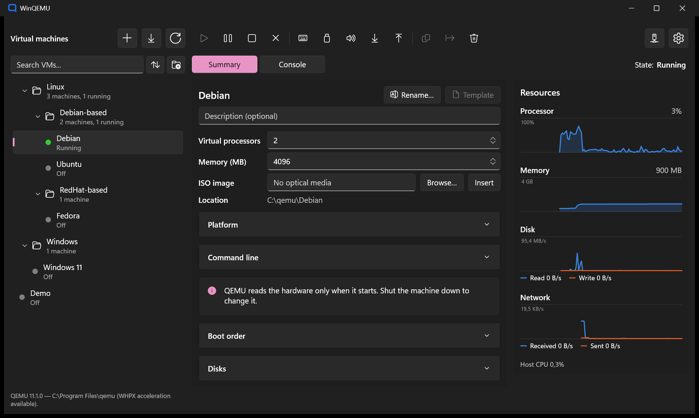
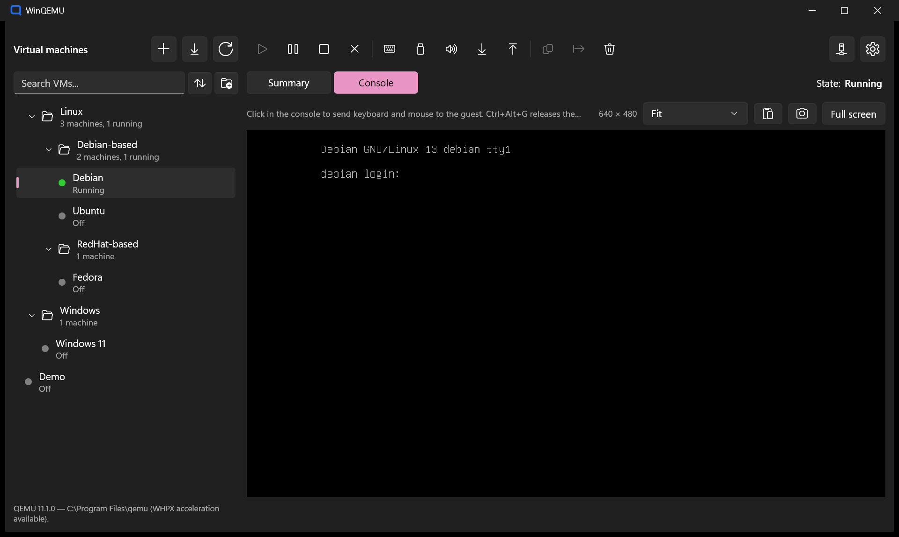
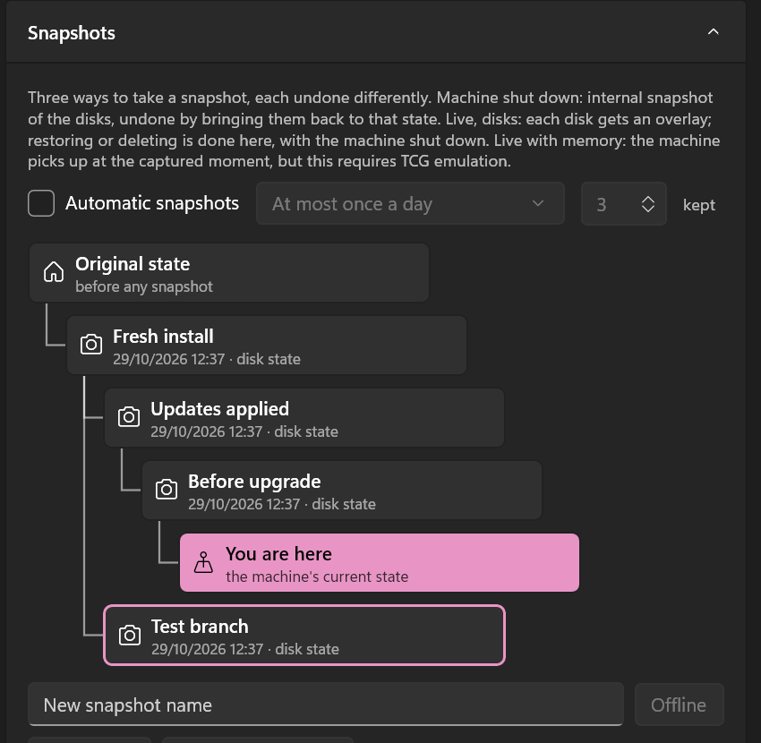

**English** · [Français](README.fr.md)

# WinQEMU

A Windows interface (WinUI 3) over [QEMU](https://www.qemu.org/), aiming at the comfort of VMware Workstation or
Hyper-V. You create, run and manage virtual machines without typing a command line, with hardware acceleration
through the Windows Hypervisor Platform (WHPX).





> WinQEMU is an independent, unofficial interface: it is neither affiliated with nor endorsed by the QEMU project.
> QEMU is a trademark of Fabrice Bellard. This project is unrelated to the old port of QEMU to Visual C++ also named
> WinQEMU (SourceForge, 2009), abandoned since.

## Features

### Virtual machines

- **Library**:
  - each machine is a self-contained folder (`.wqvm` descriptor, disks, UEFI NVRAM) that can be moved as is;
  - the machines are arranged in nested folders, sorted, and searched;
  - a whole folder starts, shuts down, pauses or resumes in one click, as VMware's teams do: its machines start one after
    the other, each after its own delay.
- **Creation wizard**:
  - guest system profiles;
  - memory, processors, disks, ISO, BIOS or UEFI firmware.
- **Unattended installation** of Windows 10/11 and Ubuntu:
  - user account, language, keyboard and time zone taken from this PC;
  - guest tools installed automatically.
- **Windows 11 guests**: the TPM and Secure Boot checks, impossible under WHPX, are lifted at installation.
- **Import** from VMware (`.vmx`), VirtualBox (`.vbox`), Hyper-V (`.vhdx`/`.vhd`) and OVF/OVA:
  - the disks are converted to qcow2;
  - the source machine is only read.
- **Export** to OVA, readable by VMware and VirtualBox.
- **Clones**, as full copies or as linked clones that share the original's disks.
- **Templates**: a machine kept to be deployed as new linked clones in seconds.
- **Automatic start** with WinQEMU, at Windows logon if you want, each machine after its own delay.
- **Running in the background**:
  - closing the window leaves the machines running, behind an icon in the notification area;
  - Windows shutdown or sign-out waits for the guests to shut down.

### Console

- **Integrated console**, or full screen with a floating bar.
- **Display scaling**: fit to the window or actual size. The guest's resolution follows the window, Windows guests included.
- **Keyboard** sent as scancodes, AltGr included: the guest uses its own keyboard layout.
- **Pointer**: accurate even when the image is scaled.
- **Shared clipboard** (text) with guests that run `spice-vdagent`.
- **Type the clipboard** into guests without a shared clipboard: a text console, an installer, a firmware screen.
- **Screen capture** to PNG, at the guest's resolution, also copied to the clipboard.
- **Files**:
  - files and folders dropped on the console are copied to the guest's desktop;
  - files are copied back from the guest through a browser of its folders.
- **Sound**:
  - per-machine volume and mute;
  - optional microphone;
  - a choice of output device.
- Ctrl+Alt+Del, and swapping the ISO while the machine runs.

### Snapshots

- **Three kinds**, offered only when the machine's state allows them:
  - offline (machine stopped);
  - live on the disks (machine running);
  - live with memory (under TCG emulation only).
- **Snapshot tree**, drawn downwards like a file tree, with deployed linked clones.

  

- **Automatic snapshots** at start, at an interval, keeping only the latest ones.

### Disks

- **Disk operations**: create, attach, grow and convert disks; set the boot order.
- **Compaction** gives back the space of files deleted in the guest, after a TRIM sent through the guest agent.
- **Encryption** (LUKS, AES-256):
  - the password is asked at each start, or remembered in the Windows Credential Manager;
  - it is never passed on a command line.

### Network and devices

- **NAT**, with port forwarding.
- **Virtual networks**, as in VMware and Hyper-V:
  - **private** (machines only);
  - **internal** (machines and this PC, through a TAP-Windows adapter);
  - **external** (the physical network, through Npcap, Wi-Fi included).
- **Access from the network**: SSH, Remote Desktop, HTTP… opened in one click, with the address to type from another device.
- **Network cable** plugged in or out while the machine runs.
- **Shared folders**:
  - served by WinQEMU itself, added and removed while the machine runs;
  - mounted in `~/Shares` in a Linux guest (9P) and as a drive in a Windows guest (WebDAV).
- **USB devices** of this PC connected to a guest, now or at each start, for devices on the WinUSB driver.
- **Guest tools** (QEMU guest agent, spice-vdagent, virtio-win drivers) checked at each start, and installed from WinQEMU.
- **Resource charts**: processor, memory, disk and network over the last two minutes.

### Command line

The `winqemu` command drives the running WinQEMU, starting it in the notification area if needed: a machine started
from a terminal is the one the window shows.

```text
winqemu list [--folder <folder>] [--json]
winqemu status <machine>
winqemu start <machine> [--wait] [--password-stdin]
winqemu stop <machine> [--wait] [--timeout <seconds>]
winqemu poweroff <machine>
winqemu pause <machine> | resume <machine>
winqemu start|stop|pause|resume --folder <folder>
winqemu snapshot list|create|restore|delete <machine> [<name>]
winqemu show [<machine>]
```

### Interface

- **Language**: English or French, Windows' language by default, switched at once.
- **Theme**: light, dark, or Windows' own.
- **Layout**: adapts down to an 800-pixel-wide window.

## Requirements

- Windows 10 1809 or later (Windows 11 recommended), x64.
- **QEMU for Windows**, installed separately: WinQEMU neither bundles nor downloads it.
  - It finds the usual installations by itself: the [qemu.weilnetz.de](https://qemu.weilnetz.de/w64/) installer, `winget install SoftwareFreedomConservancy.QEMU`, Chocolatey, Scoop, MSYS2, `PATH`.
  - Otherwise, you point it at the folder.
  - Developed with QEMU 11.1.
- For acceleration, the **Windows Hypervisor Platform** feature. WinQEMU checks it and offers to enable it (one
  administrator prompt, then a restart); by hand, as administrator:

  ```powershell
  Enable-WindowsOptionalFeature -Online -FeatureName HypervisorPlatform
  ```

  Without it, machines still run, in emulation, about ten times slower.

- Optional, depending on what you use:
  - [Npcap](https://npcap.com/) for external virtual networks;
  - the WinUSB driver (for example through [Zadig](https://zadig.akeo.ie/)) for USB devices;
  - the [virtio-win](https://github.com/virtio-win/virtio-win-pkg-scripts) ISO for Windows guests' drivers.

## Installation

Download the latest version from the [releases](https://github.com/troposteff/WinQEMU/releases):
`WinQEMU_<version>_x64.msix`, `WinQEMU.cer`, `Install-WinQEMU.ps1` and `SHA256SUMS.txt`, into one folder. Then, in
PowerShell **as administrator**, from that folder:

```powershell
Set-ExecutionPolicy -ExecutionPolicy Bypass -Scope Process -Force
.\Install-WinQEMU.ps1
```

The first line allows scripts in this PowerShell window only (Windows refuses them by default); it leaves this PC's
setting unchanged.

> **Smart App Control**: on a PC where it is on, WinQEMU installs but does not start. It only runs applications known to
> Microsoft or signed by a public authority, and WinQEMU is signed by its author. See
> [`docs/distribution.md`](docs/distribution.md#smart-app-control).

The script checks the package against `SHA256SUMS.txt` and its signature against `WinQEMU.cer`, adds the certificate to
this PC's Trusted People (not as a root authority), then installs WinQEMU. The package is signed by its author, not by a
public authority. WinQEMU then appears in the Start menu, and `winqemu` works in a terminal.

At first start, WinQEMU says whether this PC is ready to run machines (QEMU, hardware acceleration) and what to do if not.
That check stays available in the settings (**Check this PC…**).

### Betas and releases

The 2026.0.x versions are **betas**, published as pre-releases: install each one from its `.msix`. From version 2026.1.0,
releases come with `WinQEMU.appinstaller`: a PC installed from it is updated by Windows itself, in the background.

### Updating

Install the newer `.msix` (double-click it, or run `Install-WinQEMU.ps1` again). The update is in place: the settings, the
library and the virtual machines are kept.

### Verifying a download

Each release lists the SHA-256 of its files in `SHA256SUMS.txt`. In PowerShell:

```powershell
Get-FileHash .\WinQEMU_<version>_x64.msix -Algorithm SHA256
```

The value must be the one in `SHA256SUMS.txt`. The package's signature can be read in its Properties, Digital Signatures
tab: `troposteff`.

### Uninstalling

Uninstall WinQEMU from Settings, Apps (or `Get-AppxPackage *cfde84db* | Remove-AppxPackage`). This removes the application
and its settings; **the virtual machines stay** in their folder (`Documents\WinQEMU VMs` by default, or the one chosen in the settings), and a new
installation finds them once that folder is given again. The certificate can be removed from `certlm.msc`, Trusted
People.

## Building from source

You need the .NET 8 SDK.

```powershell
dotnet test WinQEMU.Core.Tests
dotnet build WinQEMU\WinQEMU.csproj -c Debug -p:Platform=x64 -p:RuntimeIdentifier=win-x64
```

The application is an MSIX package: `WinQEMU.exe` run directly does not start. Register the package on the build folder
once (later builds are picked up without registering again), then start it from the Start menu:

```powershell
Add-AppxPackage -Register WinQEMU\bin\x64\Debug\net8.0-windows10.0.19041.0\win-x64\AppxManifest.xml
```

A running WinQEMU locks its files: close it before building again. `tools/Build-Package.ps1` builds the signed,
installable package; [`docs/distribution.md`](docs/distribution.md) describes packaging, signing and releases.

## Known limits under WHPX

They come from the hypervisor, not from QEMU or WinQEMU:

- **No memory snapshot** of an accelerated machine: only the disks are captured. Memory snapshots need TCG emulation.
- **No Secure Boot, no TPM**: Windows 11 guests are installed with the hardware check lifted.
- A guest reboot under UEFI restarts QEMU from cold (no warm reset).

## Project layout

| Project | Role |
|---|---|
| `WinQEMU.Core` | Models, QEMU command line, VM lifecycle, QMP, `qemu-img`, QEMU detection, import and export, networks, sharing. |
| `WinQEMU` | The WinUI 3 application: main window, dialogs, integrated console. |
| `WinQEMU.Cli` | The `winqemu` command. |
| `WinQEMU.Core.Tests` | xUnit tests of the core. Those that call the real `qemu-img` are skipped when QEMU is not installed. |

Architecture decisions and the platform pitfalls met along the way are described, in French, in
[`CLAUDE.md`](CLAUDE.md).

## License

Copyright © 2026 troposteff.

WinQEMU is free software, distributed under the [GNU General Public License, version 3](LICENSE) (GPL-3.0). You may
redistribute it and modify it under its terms. It comes with no warranty.

The bundled TAP-Windows driver ([`WinQEMU/Assets/Drivers`](WinQEMU/Assets/Drivers/README.txt)) is the work of
OpenVPN Inc. and stays under its own license, the GPL version 2.
